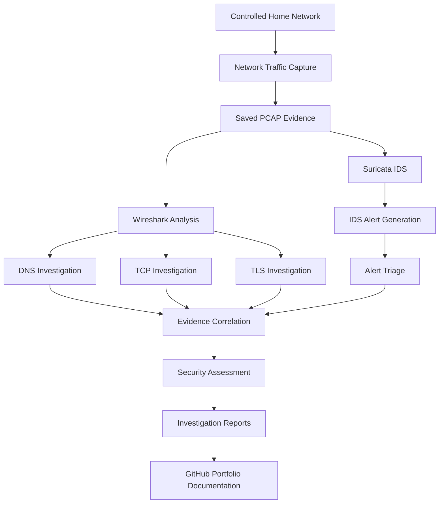
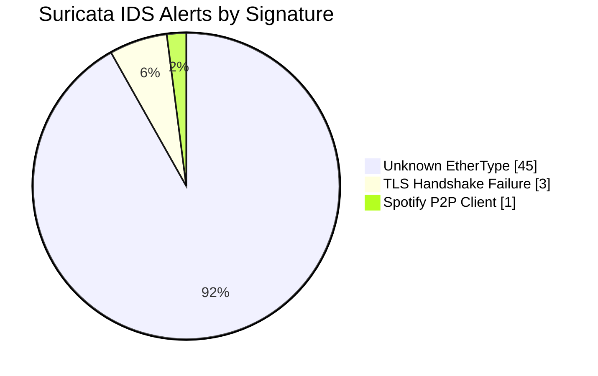

# Network Intrusion Detection Lab

### Network Traffic Analysis | Suricata IDS | Security Alert Investigation


**Project Type:** Cybersecurity Homelab
**Focus:** Network Security, Intrusion Detection, SOC Analysis
**Environment:** Controlled Home Network
**Status:** Baseline Investigation Completed

---

## 1. Project Overview

This project demonstrates practical network security monitoring and intrusion detection techniques using Wireshark and Suricata IDS.

Real network traffic was captured in a controlled home-network environment and examined to understand normal network behavior, investigate protocol activity, and analyze security alerts.

The investigation focused on four areas:

- DNS traffic analysis
- TCP connection and retransmission analysis
- TLS encrypted communication analysis
- Suricata intrusion detection alert investigation

The objective was to develop hands-on experience with network traffic investigation, security event interpretation, and evidence-based incident assessment.

**Final Result:** The Suricata investigation identified 49 alerts across three detection signatures. No confirmed malicious activity was established from the available evidence.

---

## 2. Project Objectives

The primary objectives of this lab were to:

1. Capture and inspect real network traffic.
2. Understand DNS, TCP, and TLS communication.
3. Identify network anomalies and unusual protocol behavior.
4. Analyze Suricata intrusion detection alerts.
5. Correlate IDS detections with Wireshark packet evidence.
6. Distinguish informational alerts from confirmed security incidents.
7. Document investigation findings using a structured analytical approach.
8. Establish a baseline for future intrusion detection testing.

---

## 3. Tools and Technologies

| Technology | Purpose |
|---|---|
| Wireshark | Packet capture and protocol analysis |
| Suricata IDS | Network intrusion detection and signature-based alerting |
| TCP/IP | Network communication and connection analysis |
| DNS | Domain name resolution investigation |
| TLS | Encrypted communication and handshake analysis |
| Terminal | Command-line investigation and workflow management |
| Git | Version control |
| GitHub | Security investigation documentation and portfolio hosting |
| Markdown | Structured technical reporting |

---

## 4. Lab Architecture and Workflow

The project used a controlled network environment to capture traffic, analyze communication patterns, and investigate intrusion detection alerts.



### Investigation Process

**Step 1 — Capture Traffic**

Collect network traffic from the controlled environment.

**Step 2 — Analyze Protocols**

Use Wireshark to examine DNS resolution, TCP connections, and TLS negotiation.

**Step 3 — Generate IDS Alerts**

Process the saved network capture using Suricata IDS and its installed detection rules.

**Step 4 — Investigate Alerts**

Review Suricata detections and correlate them with available packet-level evidence.

**Step 5 — Assess Security Significance**

Distinguish expected network activity, observable anomalies, and potentially suspicious events.

**Step 6 — Document Findings**

Record observations, supporting evidence, limitations, and conclusions in investigation reports.

---

## 5. Investigation Reports

Four investigations were completed and documented.

| Investigation | Description | Report |
|---|---|---|
| DNS Analysis | DNS queries, responses, and resolution behavior | [View Report](reports/01-dns-analysis.md) |
| TCP Analysis | Connection establishment, duplicate ACKs, and retransmissions | [View Report](reports/02-tcp-analysis.md) |
| TLS Analysis | TLS handshake behavior and encrypted communication | [View Report](reports/03-tls-analysis.md) |
| Suricata IDS | Detection signatures, alert triage, and packet correlation | [View Report](reports/04-suricata-alert-analysis.md) |

---

## 6. Key Investigation Findings

### Investigation 1 — DNS Traffic Analysis

**Objective:** Examine DNS query and response behavior to understand domain name resolution.

**Observed Results:**

- Analyzed DNS resolution for `example.com`.
- Identified a successful DNS query and response exchange.
- Observed two IPv4 addresses returned by the resolver.
- Recorded a DNS response time of 34.77 milliseconds.
- Confirmed that the query and response shared the same DNS transaction ID.
- No DNS errors were identified in the investigated exchange.

**Security Assessment:**

The observed DNS exchange was consistent with normal domain name resolution.

No suspicious activity was identified in the specific exchange. Additional traffic analysis would be required before making broader security conclusions.

**Skills Demonstrated:**
DNS analysis, transaction correlation, protocol interpretation, and network baseline assessment.

[Read Full DNS Investigation](reports/01-dns-analysis.md)

---

### Investigation 2 — TCP Connection Analysis

**Objective:** Investigate TCP connection establishment, acknowledgment behavior, and retransmission events.

**Observed Results:**

- Identified a successfully established TCP connection.
- Recorded a handshake completion interval of 272.095 milliseconds.
- Observed duplicate TCP acknowledgments.
- Identified a retransmission at packet 488.
- Observed subsequent TLS negotiation and encrypted application traffic.

**Security Assessment:**

The connection was successfully established.

Duplicate acknowledgments and retransmissions represented observable network anomalies, but the underlying cause could not be determined from the available evidence alone.

No malicious activity was established in this investigation.

**Skills Demonstrated:**
TCP handshake analysis, retransmission identification, connection troubleshooting, and evidence-based network assessment.

[Read Full TCP Investigation](reports/02-tcp-analysis.md)

---

### Investigation 3 — TLS Encrypted Traffic Analysis

**Objective:** Examine TLS handshake behavior and understand how encrypted connections are negotiated.

**Observed Results:**

- Investigated TLS handshake communication.
- Examined modern TLS encryption negotiation.
- Reviewed cryptographic parameters associated with the connection.
- Distinguished legacy TLS version fields from the negotiated protocol version.
- Observed that application content was protected by encryption.
- Identified that some connection metadata remained observable to network monitoring tools.

**Security Assessment:**

The investigated connection negotiated modern encryption parameters.

The available handshake evidence did not establish malicious activity.

**Skills Demonstrated:**
TLS handshake analysis, encrypted traffic interpretation, cryptographic parameter identification, and security protocol investigation.

[Read Full TLS Investigation](reports/03-tls-analysis.md)

---

### Investigation 4 — Suricata IDS Alert Analysis

**Objective:** Process a saved network capture using Suricata IDS, investigate generated alerts, and correlate detections with packet evidence.

**Observed Results:**

Suricata successfully processed the saved network capture and generated **49 alerts across three detection signatures**.

#### Detection Summary

| Detection Signature | Alert Count | Assessment |
|---|---:|---|
| Unknown EtherType | 45 | Likely benign link-layer activity |
| TLS Handshake Failure | 3 | Confirmed negotiation failures; cause undetermined |
| Spotify P2P Client | 1 | Likely benign informational activity |
| **Total** | **49** | **No confirmed intrusion** |

#### Alert Distribution



**Security Assessment:**

The investigation distinguished IDS detection events from confirmed security incidents.

- Link-layer detections were assessed as likely benign.
- Three TLS handshake failures were observed, but their underlying cause was not established.
- One Spotify P2P signature was assessed as likely benign informational activity.
- No confirmed malicious activity was identified from the available packet evidence.

The results demonstrate why security analysts must investigate alerts before classifying them as incidents.

**Skills Demonstrated:**
IDS alert triage, Suricata signature interpretation, packet correlation, false-positive assessment, and security incident documentation.

[Read Full Suricata Investigation](reports/04-suricata-alert-analysis.md)

---

## 7. SOC Analyst Skills Demonstrated

This project provides practical experience with several responsibilities associated with entry-level Security Operations Center roles.

| SOC Skill | Practical Application |
|---|---|
| Network Traffic Analysis | Examined DNS, TCP, and TLS communication |
| Intrusion Detection | Processed network traffic using Suricata IDS |
| Alert Triage | Reviewed 49 detection events across three signatures |
| Packet Investigation | Used Wireshark to examine network evidence |
| Protocol Analysis | Investigated DNS resolution, TCP behavior, and TLS negotiation |
| Evidence Correlation | Connected IDS detections with packet-level observations |
| Anomaly Assessment | Evaluated retransmissions and TLS handshake failures |
| False-Positive Assessment | Distinguished likely benign detections from confirmed threats |
| Security Documentation | Produced four structured investigation reports |
| Version Control | Published sanitized technical documentation using Git and GitHub |

### Technical Competencies

`Wireshark` `Suricata` `Network Security` `TCP/IP` `DNS` `TLS` `Packet Analysis` `IDS` `Alert Triage` `Security Monitoring` `Git` `GitHub`

---

## 8. Investigation Limitations

This project represents a baseline intrusion detection investigation rather than a production security monitoring system.

The following limitations apply:

- Traffic analysis was performed using a limited saved network capture.
- Continuous or real-time monitoring was not implemented.
- Alert assessments relied on available packet evidence and Suricata detection metadata.
- Endpoint telemetry and process-level information were not included in the investigation.
- Historical network activity was limited.
- No confirmed intrusion was established.

**Important:** The absence of confirmed malicious activity does not prove that the network was free from compromise.

Additional telemetry and investigation would be required to establish broader security conclusions.

---

## 9. Future Improvements

Potential future enhancements include:

- Implementing continuous Suricata network monitoring.
- Developing custom IDS detection rules.
- Testing detections using authorized, controlled security simulations.
- Integrating Suricata alerts with a SIEM platform.
- Building dashboards for security event visualization.
- Correlating network alerts with endpoint and system logs.
- Expanding investigations to additional network protocols.
- Automating alert collection and investigation workflows.

These enhancements are planned opportunities and are not represented as completed functionality.

---

## 10. Evidence Privacy and Anonymization

This project uses real network traffic captured in a controlled home-network environment.

To protect device and network privacy:

- Private device IP addresses in published reports were replaced with documentation-only IP addresses from the `192.0.2.0/24` range.
- A device-specific MAC address was replaced with a locally administered example MAC address.
- The original LAN broadcast destination was represented using `192.0.2.255`. This is a documentation placeholder, not an actual observed broadcast address.
- Original PCAP captures and Suricata logs are retained locally and excluded from Git tracking.
- Publicly documented findings preserve the relevant protocols, ports, alert classifications, and investigation conclusions.

All anonymized addresses are illustrative and should not be interpreted as the original observed network identifiers.

### Evidence Handling

The repository intentionally excludes raw packet captures and security logs to reduce unnecessary exposure of network and device information.

Only sanitized investigation documentation is published.

---

## 11. Project Outcome

The Network Intrusion Detection Lab successfully demonstrated a structured approach to network security investigation.

The project included:

- Four completed network security investigations.
- DNS, TCP, and TLS packet-level analysis.
- Suricata IDS processing and alert investigation.
- Analysis of 49 detection events.
- Correlation of IDS alerts with Wireshark evidence.
- Security assessments based on observed network behavior.
- Sanitized technical documentation published through GitHub.

**Overall Conclusion:**

No confirmed malicious activity was identified in the analyzed evidence.

The investigation established a documented baseline that can support future intrusion detection testing, controlled security simulations, and more advanced SOC monitoring projects.

---

## 12. Repository Structure

```text
network-intrusion-detection-lab/
|
|-- README.md
|-- .gitignore
|
|-- reports/
|   |-- 01-dns-analysis.md
|   |-- 02-tcp-analysis.md
|   |-- 03-tls-analysis.md
|   |-- 04-suricata-alert-analysis.md
|
|-- captures/       (Local only - excluded from Git)
|-- logs/           (Local only - excluded from Git)
```

Additional local directories may contain supporting lab materials that are not included in the published repository.

---

## 13. Related Cybersecurity Projects

### AWS Security Monitoring Lab

A separate cloud security project focused on AWS CloudTrail logging, CloudWatch metric filters, security alarms, and SNS email notifications.

[View AWS Security Monitoring Lab](https://github.com/Taseenarshad/aws-security-monitoring-lab)

---

## Author

**Taseen Arshad**

B.S. Information Systems | University of Texas at Arlington

Interested in cybersecurity, network security, security operations, cloud security, and information technology.

[GitHub Profile](https://github.com/Taseenarshad)

---

*This project was completed for educational purposes in a controlled environment. All published network identifiers have been anonymized.*
